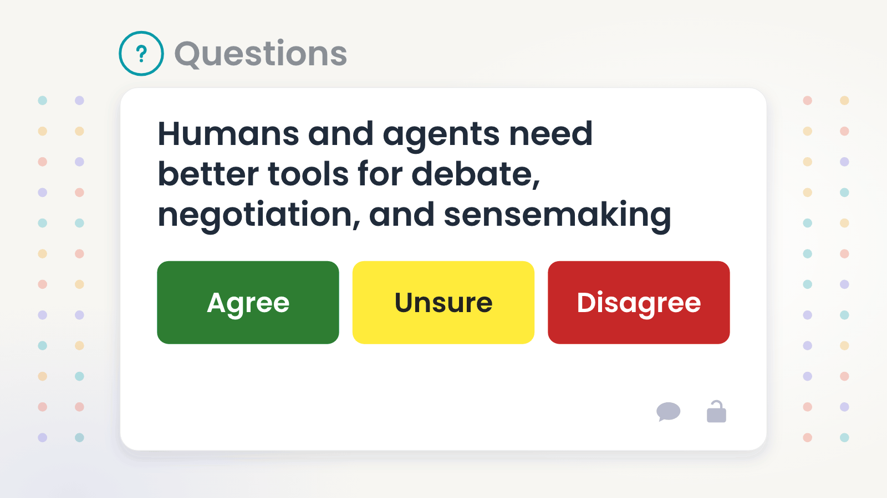
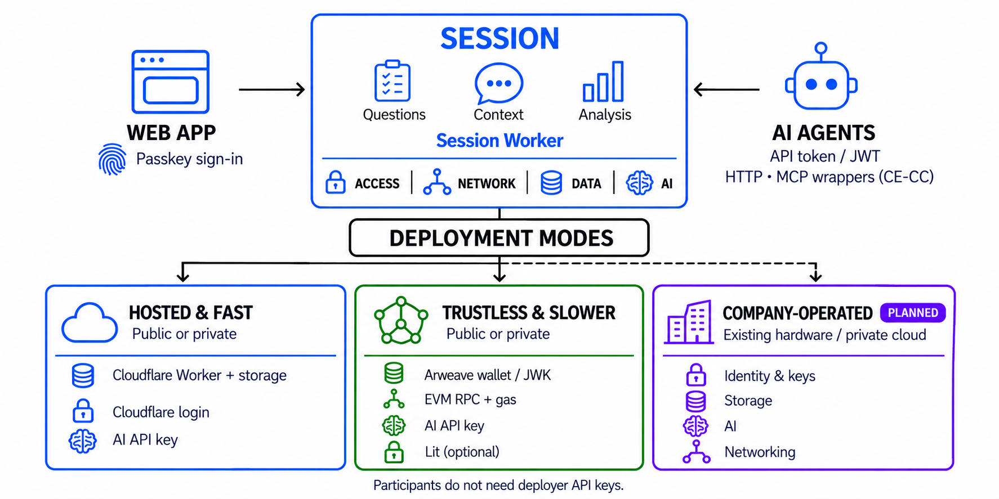

# Context Engine


<p align="center">
  
</p>

**Live demo:** [contextengine.sh](https://contextengine.sh)

Context Engine is a toolkit for AI-enhanced deliberation, decision-making, and negotiation in large groups. It supports public and private questions and responses, AI-assisted input and analysis, permanent records, and cryptographic access control. It allows for no-code deployment of [Soulbound Tokens](https://www.radicalxchange.org/wiki/social-identity/) (SBTs) for Groups. Designed for use cases such as public discourse, organizational decision-making, preference-related dataset creation, and turning stakeholder feedback into company-specific AI evaluations.

## Architecture At A Glance

<p align="center">
  
</p>

Two decisions shape a deployment, and they are independent: where the web interface is hosted, and which infrastructure each session runs on.

**Web interface.** Use the front-end at [contextengine.sh](https://contextengine.sh), or host the static client on your own domain. Passkeys are tied to the domain they are created on, so choose the domain first.

**Session profile.** Each session decides who controls access and where its data lives. **Hosted & Fast**, where `/new` starts, runs the session on a Cloudflare Worker in the creator's own account, with no blockchain or gas by default. **Trustless & Slower** registers it on a public EVM chain and stores its data publicly on Arweave. **Company-Operated**, on an organization's own infrastructure, is planned. [Session Infrastructure Profiles](docs/run-modes.md#session-infrastructure-profiles) describes what each needs and who can read its data.

The former `.xyz` address redirects to [contextengine.sh](https://contextengine.sh). Participants never need deployer API keys.

## Quick Start

### Prerequisites

- Root scripts, worker bundling, contract tooling, and client workflows: Node.js 20.19+ or 22.12+ with npm 10
- Foundry (`forge` / `anvil`) for local-chain and root contract test workflows

### Clone and Install

```bash
git clone https://github.com/AgalmicSoftware/context-engine.git
cd context-engine

nvm use 20
npm install
npm --prefix client install
npm --prefix client run dev
```

The React app runs on `http://localhost:3000`.

For testing, run modes, and deeper setup:
- [docs/testing.md](docs/testing.md)
- [docs/run-modes.md](docs/run-modes.md)
- [docs/session-creation-guide.md](docs/session-creation-guide.md)
- [docs/public-client-config.md#netlify-static-deploy](docs/public-client-config.md#netlify-static-deploy) for Netlify/custom-domain static frontend deploys

## Features

### Survey and Response Management
- Multiple question types: freeform, single- and multi-select, binary, rating scales, and quadratic allocation
- Optional encryption of responses and results
- Optional decentralized and permanent response storage in the public Arweave-backed profile
- Statistical / AI analysis and visualization of results
- Export results as `.json`, `.csv`, `.html`, `.pdf`

### Groups
- Cloudflare Groups for membership, invitations, and response filtering in Worker-backed sessions
- Optional no-code creation of Soulbound tokens ([SBTs](https://www.radicalxchange.org/wiki/social-identity/)) for chain-backed groups
- Public minting, password-protected minting, time-limited minting, limited-number minting, and auto-claim URLs
- Role-based burn authorization (admin, minter, both, neither)
- Session and resource gating based on SBT ownership (encrypted titles, information, docURLs, tags)

### AI-Assisted Tooling
- Voice-to-text input
- Question generation from file, URL, or text input
- Summaries and analysis of survey results and response clusters
- Optional interview research metadata for comparing AI draft predictions with reviewed submitted responses; see [the interview research diagrams](docs/assets/interview-research/README.md) and [schema notes](docs/session-interview-research.md)
- Export deliberation snapshots and consensus statistics as evaluation / preference datasets for AI benchmarking and training
- OpenAI, Anthropic, OpenRouter, and custom provider paths

### Group Agent

A session on a Session Worker can have a Group Agent: an AI that answers questions about the session from its own material. It is off until an admin turns it on under AI, on `/new` or in the session's Settings. While it is on, a robot by the session's title says so, and anyone signed in can open it from the session's Context.

- **Who may ask.** An admin lists audiences in order (everyone signed in, members of chosen groups, or SBT holders) and gives each General or Detailed answers. The first audience a person matches sets how they are answered. Admins always get Detailed answers. Anyone asking also needs the session's AI access.
- **General answers** draw on the session's context, the files everyone may see, and the results the asker may see. They never use members' answers or files locked to a group.
- **Detailed answers** draw on everything the asker may see, and on members' answers. No answer names anyone. The Session Worker, not the page, decides what each style reads.
- **Keeping your answers and files out.** They are in unless you say otherwise. Open the Group Agent and turn off **Use my answers and files**: from the next question on, it leaves out your answers and the files you added. Your files stay in the session's file list, and answers already given can't be taken back. You can turn it off even when the Group Agent doesn't answer you, and turn it back on at any time.
- **Nothing is kept.** The session keeps no questions or answers, and an answer is at most 150 words.

Setup, limits and routes: [docs/group-agent.md](docs/group-agent.md).

### Agent Access

- MCP server for AI agents that take part in hosted or unencrypted registry sessions as their own
  participants, answering, adding statements and claiming session SBTs with
  their own keys. Run the latest published package with `npx -y --prefer-online @agalmic/contextengine@latest`
  from an MCP host: [mcp/README.md](mcp/README.md). Pin an exact published version
  for reproducible runs. This installs a local tool
  server; it does not deploy or upgrade the web app or Session Workers.
- Optional Session Agent HTTP with scoped `/api/agent/*` credentials and
  versioned runtime instructions
- Agent token login in the browser, one-time invites, and Session Wrapped over HTTPS
- Delegated membership, gate, storage, and chain authority rather than a second
  copy of canonical session state
- Setup and endpoint reference in
  [workers/sessionCorsWorker/agent/README.md](workers/sessionCorsWorker/agent/README.md)

### User and Deployer UX: Passkey Sign-On

- Users log in with a simple passkey / biometric flow (native PIN, fingerprint, or Face ID on phones)
- Login supplies a signing account for session identity; EVM-backed profiles can also use it as a chain account
- By default, Hosted & Fast does not submit an EVM transaction, and its users do not need Ethereum, a wallet balance, or gas

### Deployer UX: Sponsored Bundles

- Setup requirements follow the selected profile; [Session Infrastructure Profiles](docs/run-modes.md#session-infrastructure-profiles) lists them
- Sponsored bundles and advanced configuration can supply Arweave, EVM/RPC, Lit, or other credentials only when the selected decentralized or encrypted profile needs them; planned company-operated adapters will connect internal services instead

## AI Discourse Corpus

The top-level [`ai-discourse-corpus/`](ai-discourse-corpus/) directory contains reusable JSON sub-corpuses curated from AI policy, safety, governance, science fiction, practitioner interviews, evaluation work, debates, and enriched social-media discussion. Rights for that directory are described separately in [ai-discourse-corpus/LICENSE.md](ai-discourse-corpus/LICENSE.md): no ownership is claimed over upstream source material, and project-authored annotations are dedicated under CC0.

## AI Opinions Benchmark

The top-level [`ai-discourse-bench/`](ai-discourse-bench/) package turns source-grounded question banks into repeated, polarity-reversed model runs and static Context Engine results reports. The client serves its bundled report index at `/benchmarks`, where each model is treated as one participant and the report exposes agreement, disagreement, repeat stability, opinion groups, and model-trait comparisons.

Bundled reports declare their publication status. Development previews are useful for inspecting the method and interface, but a released result additionally requires a reviewed question bank, the configured repeats for both original and reversed wording, and complete valid model coverage. See the [benchmark README](ai-discourse-bench/README.md) and [methodology](ai-discourse-bench/docs/methodology.md) for local-model, OpenRouter, question-bank, and release-gate details.

## Scaling

The default public deployment supports hundreds to low thousands of concurrent participants per session. For larger deployments, see [docs/scaling.md](docs/scaling.md).

## Documentation

- Project framing: [whitepaper/whitepaper.md](whitepaper/whitepaper.md)
- System design, data flows, and file map: [ARCHITECTURE.md](ARCHITECTURE.md)
- Docs index: [docs/README.md](docs/README.md)
- User guide / end-to-end session setup: [docs/session-creation-guide.md](docs/session-creation-guide.md)
- Public posts authoring: [docs/posts.md](docs/posts.md)
- Testing guide: [docs/testing.md](docs/testing.md)
- Run modes: [docs/run-modes.md](docs/run-modes.md)
- Public client config and current defaults: [docs/public-client-config.md](docs/public-client-config.md)
- Session interview research metadata: [docs/session-interview-research.md](docs/session-interview-research.md)
- Group Agent: [docs/group-agent.md](docs/group-agent.md)
- PATH / RPC behavior: [docs/path-rpc.md](docs/path-rpc.md)
- Cloudflare worker docs: [docs/session-cors-worker.md](docs/session-cors-worker.md)
- Session Agent HTTP docs: [workers/sessionCorsWorker/agent/README.md](workers/sessionCorsWorker/agent/README.md)
- Agent participants (MCP server): [docs/agent-participants.md](docs/agent-participants.md)
- Session registry and gate model: [docs/session-registry.md](docs/session-registry.md)
- Scaling reference: [docs/scaling.md](docs/scaling.md)
- Public roadmap: [ROADMAP.md](ROADMAP.md)
- AI Opinions Benchmark: [ai-discourse-bench/README.md](ai-discourse-bench/README.md)

## Licensing

Project-authored code is licensed under `MPL-2.0`, including the client, Workers, contracts and deploy package. Earlier releases keep the licenses they shipped with. The exceptions keep their own licenses: the MP3 encoder and Classic 95 fonts (LGPL), the `hark` and `recordrtc` audio libraries (MIT), project-authored annotations in [`ai-discourse-corpus/`](ai-discourse-corpus/) (`CC0-1.0`), and other third-party dependencies, fonts and assets. See [LICENSING.md](LICENSING.md).

## Roadmap

Current priorities and future development directions live in [ROADMAP.md](ROADMAP.md).
